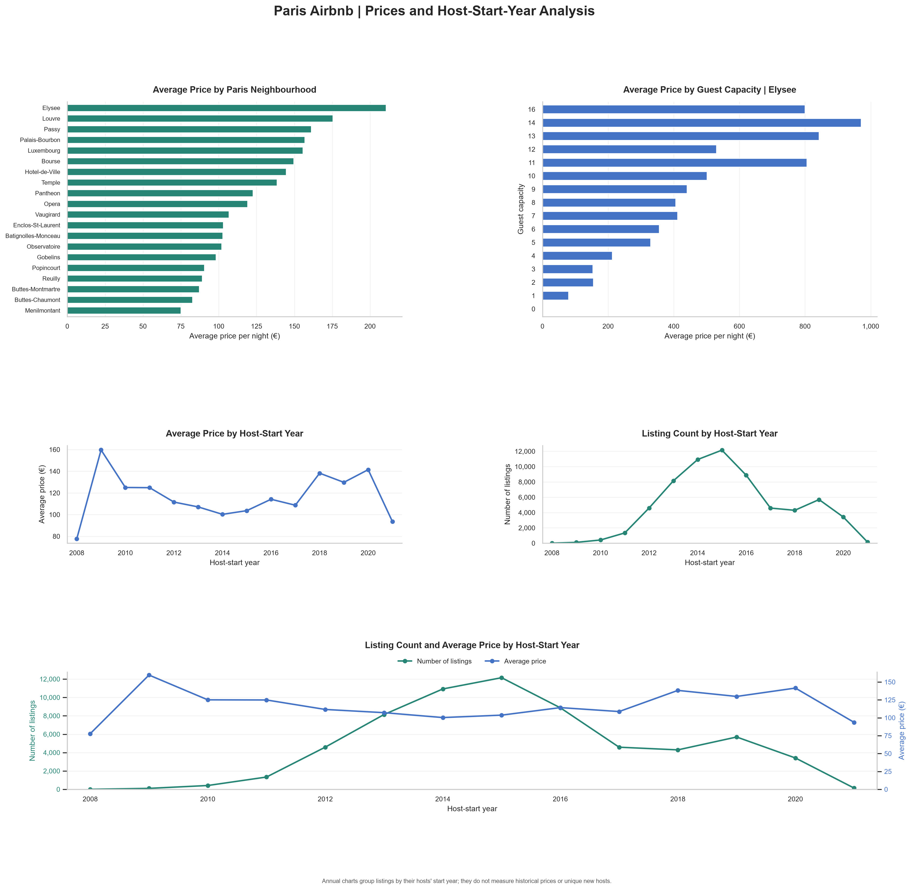

# AirBnB Listing Analysis

A Python analysis of Paris Airbnb listings exploring neighbourhood
prices, guest capacity, and host-start-year patterns.

## Dashboard



## Project objective

The project brief asked what listing data suggest about patterns
around a 2015 regulation milestone in Paris.

The analysis profiles the dataset, prepares summary tables, and
presents five charts. It distinguishes descriptive patterns from
evidence of a causal regulatory effect.

## Tools

- Python
- pandas
- Matplotlib
- seaborn
- Thonny

## Dataset

The source file is `Listings.csv`, used in the Maven Analytics
AirBnB Listing Analysis guided project.

The original dataset contains 279,712 records and 33 columns.
Filtering to Paris produces 64,690 listings.

The CSV is not included in this repository. Obtain it from the
project's original dataset source and place it in a local folder
named `data`.

## Data preparation

- Converted `host_since` into a datetime field.
- Standardized city text during filtering.
- Selected Paris listings.
- Retained host_since, neighbourhood, city, accommodates, and price.
- Checked missing values and numerical summary statistics.
- Inspected records where both price and guest capacity were zero.

The Paris subset contains 33 missing host-start dates.
The other four selected fields have no missing values.

## Dashboard charts

1. Average price by Paris neighbourhood.
2. Average price by guest capacity in Elysee.
3. Average price by host-start year.
4. Listing count by host-start year.
5. Combined listing count and average price by host-start year.

## Findings and interpretation

- Average listing prices vary substantially across neighbourhoods.
- Larger-capacity listings generally have higher average prices
  in Elysee, although the relationship is not uniform.
- The 2015 host-start-year group contains the most listing records.
- Average prices fluctuate across annual groups.

These patterns do not establish that regulations caused changes
in listing counts or prices.

## Important limitations

- `host_since` records when a host joined Airbnb, not necessarily
  when a Paris listing entered the market.
- Listing-row counts are not distinct-host counts.
- Prices grouped by host-start year are not historical annual prices.
- Records without host-start dates cannot be assigned to annual groups.
- This analysis does not control for other influences on the market.

## How to run the project

1. Download this repository.
2. Install the required packages:

   ```bash
   pip install -r requirements.txt
   ```

3. Create a folder called `data` next to the Python script.
4. Place `Listings.csv` inside the `data` folder.
5. Run:

   ```bash
   python airbnb_listing_analysis.py
   ```

You can also open the script in Thonny and run it there.
Install the dependencies in the same Python environment used
to run the script.

The script saves dashboard exports in an `outputs` folder.

## Repository files

- `airbnb_listing_analysis.py`: analysis and visualization script.
- `Paris_Airbnb_Dashboard.png`: completed dashboard image.
- `requirements.txt`: required Python packages.
- `README.md`: project explanation and setup instructions.

## Future improvements

- Count distinct hosts using `host_id`.
- Compare mean and median prices.
- Review sample sizes within capacity groups.
- Investigate zero values and extreme prices.
- Use historical listing snapshots to assess actual changes over time.
